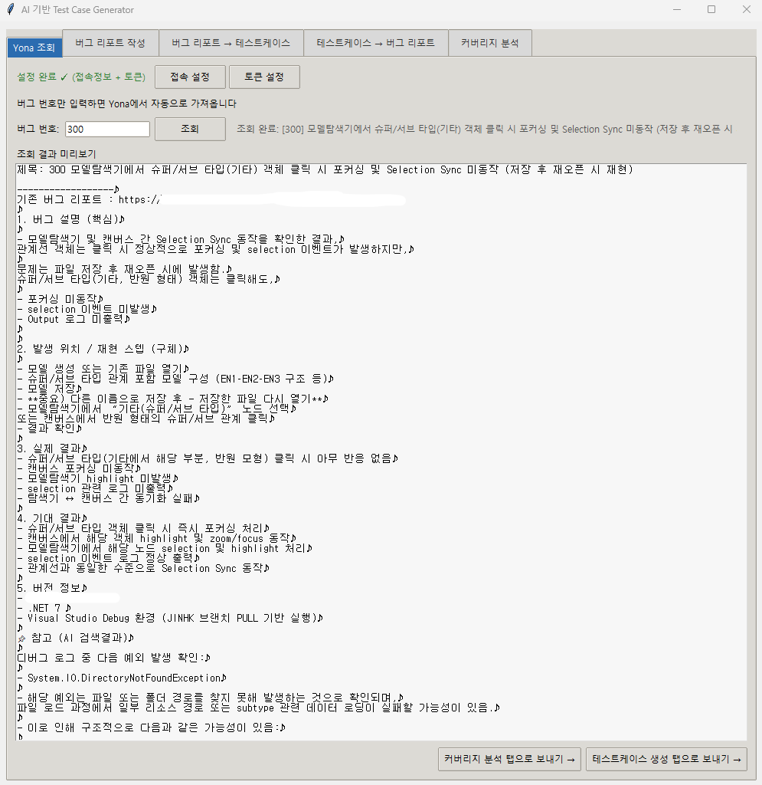
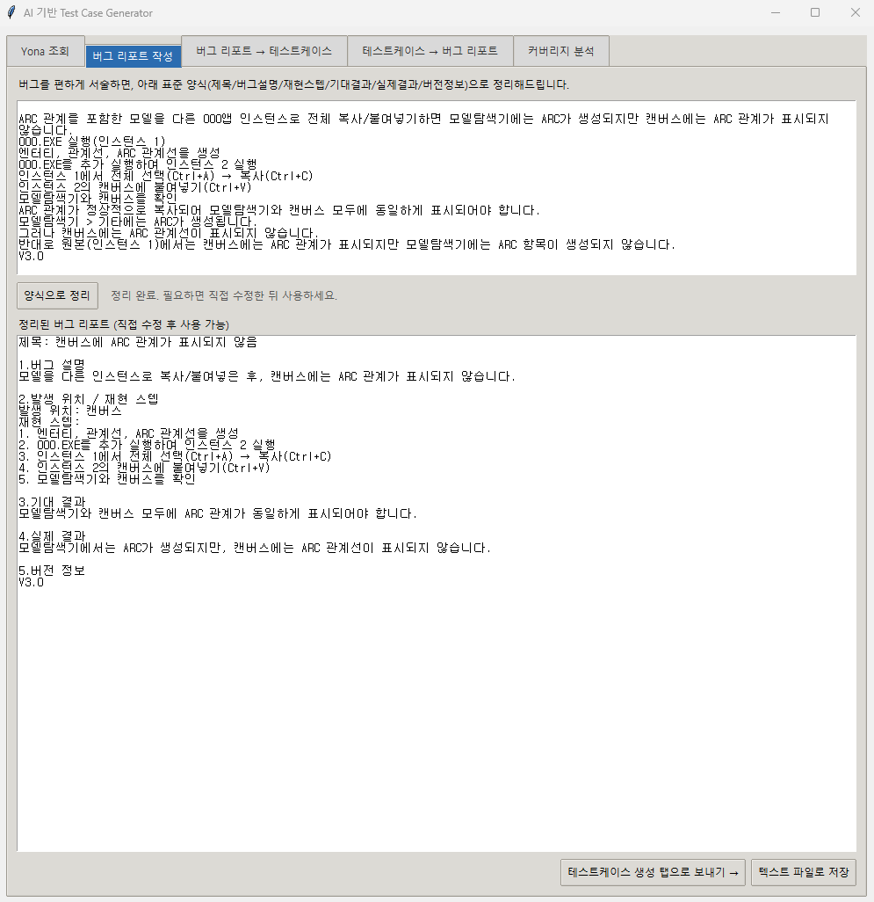
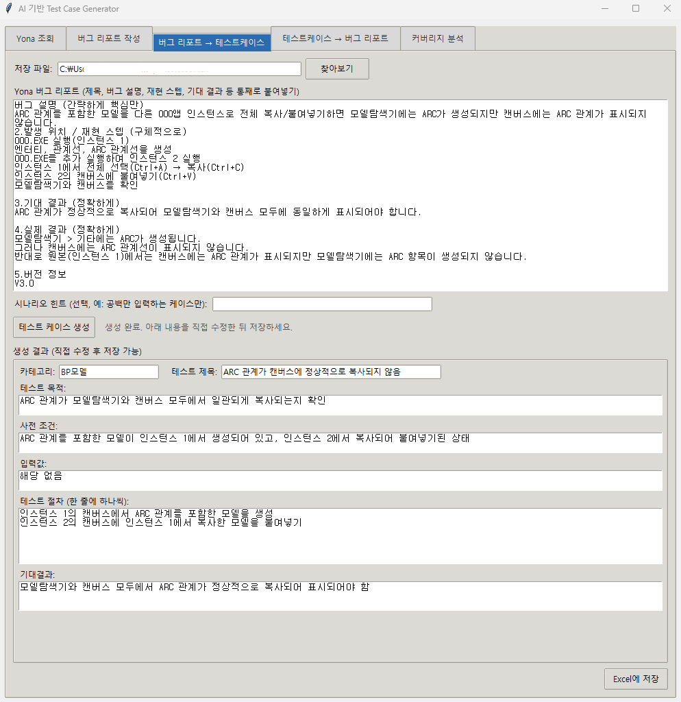
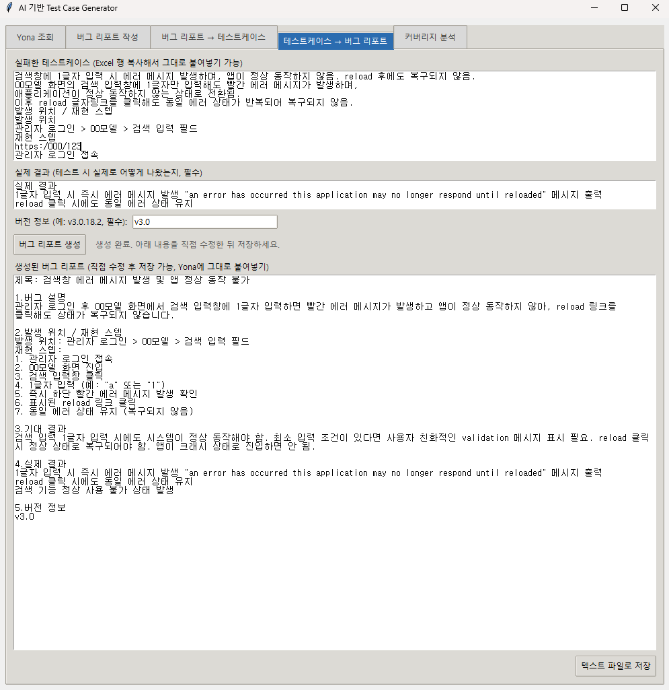
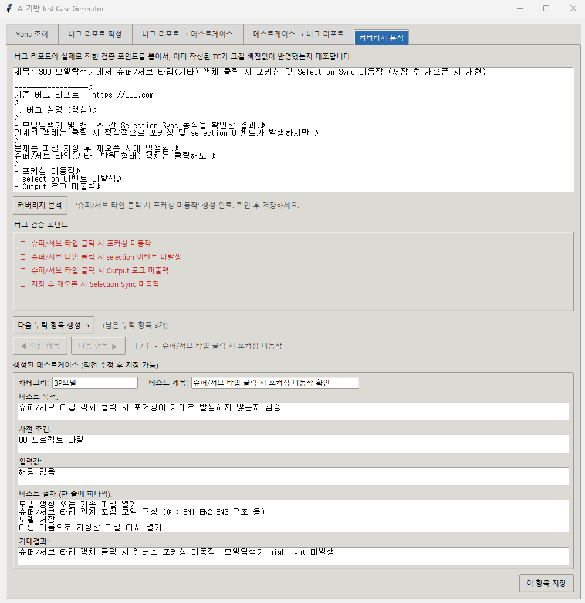
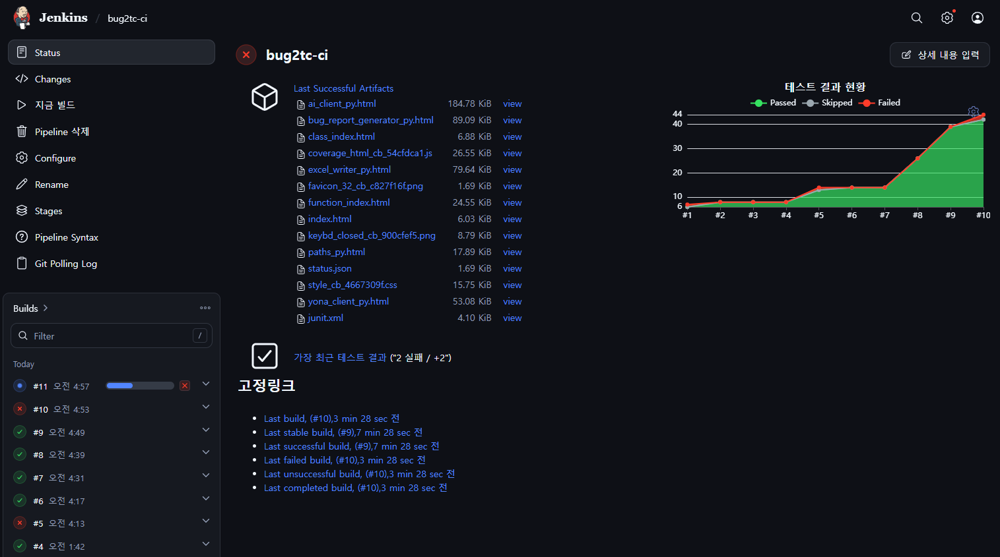

# AI 기반 Test Case Generator

**Yona 버그 리포트 ↔ QA 테스트케이스를 양방향으로 변환하는 완전 로컬 AI 도구**

로컬에서 돌아가는 AI(Ollama)만 사용합니다. API 키도, 클라우드 비용도, 외부로 나가는 데이터도 없습니다. 

인터넷은 최초 Ollama/모델 설치 때만 필요합니다.

CLI(`main.py`)와 GUI(`gui.py`) 두 가지로 쓸 수 있고, GUI는 Windows `.exe`로 패키징해 더블클릭으로 실행할 수 있습니다.

```
                        ┌───────────────────┐
                        │      CLI / GUI    │
                        └─────────┬─────────┘
                                  │
                 ┌────────────────┼────────────────┐
                 │                                 │
          버그 리포트 확보                      테스트케이스 → 버그
                 │                                  │
     ┌───────────┼───────────┐                      │
     │           │           │                      │
  직접 붙여넣기  Yona 조회   버그 리포트 작성             │
              (yona_client)  (bug_report_generator) │
     │           │           │                      │
     └───────────┴─────┬─────┘                      │
                        ↓                            ↓
              ai_client.py                 bug_report_generator.py
        (테스트케이스 생성 /                           │
         커버리지 분석)                               │
                   │                                │
                   │     ←── excel_writer.py        │
                   │      (기존 TC 조회·대조)         │
                   │                                │
                   └──────────┬─────────────────────┘
                                   ↓
                             Ollama / Qwen 2.5
                                   │
                                   ↓
                             Generated Data
                                   │
                     ┌─────────────┴─────────────┐
                     ↓                           ↓
              excel_writer.py               Text Output
              (testcase.xlsx)             (버그 리포트 / .txt)
```

---

## 주요 기능

### 1. Yona 조회


버그 번호만 입력하면 Yona API로 원문을 자동으로 가져옵니다. 첨부 이미지/영상 마크업은 자동 제거됩니다. 가져온 내용은 "버그→테스트케이스" 탭이나 "커버리지 분석" 탭으로 바로 보낼 수 있습니다.

### 2. 버그 리포트 작성


버그를 편하게 자유 서술로 적으면, 표준 양식(제목/버그설명/재현스텝/기대결과/실제결과/버전정보)으로 정리해줍니다. 서술에 없는 내용(버전 등)은 지어내지 않고 `(직접 입력 필요)`로 표시합니다.

### 3. 버그 리포트 → 테스트케이스


버그 리포트를 카테고리/제목/목적/사전조건/입력값/절차/기대결과 7개 필드의 테스트케이스로 변환해 `testcase.xlsx`에 저장합니다. TC_ID는 버그 번호 기준 자동 채번(`TC_298_01`, `02`...).

- **단일 시나리오**: CLI·GUI 모두 지원. 필요하면 시나리오 힌트 입력 가능.
- **다중 시나리오 추출**: 버그 리포트 하나에 여러 검증 케이스가 섞여 있으면 AI가 구분해서 전부 생성. **CLI 전용.**

### 4. 테스트케이스 → 버그 리포트


실패한 테스트케이스 + 실제 결과 + 버전 정보를 넣으면 Yona에 바로 붙여넣을 수 있는 버그 리포트로 변환합니다. CLI·GUI 모두 지원.

### 5. 커버리지 분석


버그 리포트에 **실제로 적힌** 검증 포인트를 추출해서(브레인스토밍이 아니라 텍스트 추출), 같은 버그 번호로 이미 작성된 TC가 그걸 빠짐없이 반영했는지 ☑/☐로 대조합니다. 

누락된 포인트만 골라 하나씩 생성할 수 있고, 방금 만든 항목은 **"◀ 이전 항목 / 다음 항목 ▶"** 버튼으로 재분석 없이 다시 확인/수정할 수 있습니다.

### 공통 안전장치
- **중복 경고**: 저장 전 기존 TC와 제목/목적 유사도를 비교해 경고 (저장을 막지는 않음, 참고용)
- **결과 직접 수정**: 생성된 모든 결과는 저장 전 자유롭게 수정 가능
- **품질 가드레일**: title에 버그 번호 미포함, 증상이 아닌 검증 목적 중심 제목, steps에 버그 증상 대신 중립적 조작만 기술, 시나리오당 검증 관심사 하나만, 사전조건에 없는 사실 지어내지 않음, 한자/영어 혼용 방지
- **파일 잠금 대응**: Excel이 열려 있어도 프로그램이 죽지 않고 안내만 표시
- **Desktop 경로 자동 감지**: OneDrive 리디렉션 환경도 대응

---

## 설치

**1) Ollama (최초 1회)**
```powershell
# https://ollama.com 에서 설치 후
ollama pull qwen2.5:7b
ollama run qwen2.5:7b   # 동작 확인, /bye로 종료
```

**2) 프로젝트**
```powershell
cd TCGenerator
python -m venv venv
.\venv\Scripts\Activate.ps1
pip install -r requirements.txt
```

## 실행

```powershell
python main.py   # CLI
python gui.py    # GUI
```

Ollama가 백그라운드에서 켜져 있어야 합니다 (설치 후 자동 실행, 재부팅 시에도 자동 시작).

**CLI 메뉴**: 버그→TC / TC→버그 / Yona 조회→TC / 커버리지 분석
**GUI 탭**: Yona 조회 / 버그 리포트 작성 / 버그→TC / TC→버그 / 커버리지 분석

## Yona 연동 설정

버그 번호로 자동 조회하려면 접속 정보가 필요합니다. **코드에는 저장되지 않고, Windows `%APPDATA%\TCGenerator\.env`에 이 PC에서만 저장됩니다** (재빌드해도 안 사라짐).

- GUI: "Yona 조회" 탭의 **"접속 설정"** / **"토큰 설정"** 버튼
- CLI: Yona 조회 메뉴 진입 시 미설정이면 그 자리에서 안내 후 입력

필요한 값: Yona 주소, Owner(팀), Project, API 토큰(Yona 계정 설정 > API Token에서 발급)

## .exe로 패키징 (선택)

```powershell
pip install pyinstaller
pyinstaller --onefile --windowed --name TCGenerator --icon=icon.ico gui.py
```

---

## 파일 구성

| 파일 | 역할 |
|---|---|
| `main.py` | CLI 진입점 |
| `gui.py` | Tkinter GUI (5개 탭, `.exe` 패키징 대상) |
| `ai_client.py` | 버그→TC 변환, 커버리지 분석 (Ollama 호출/프롬프트) |
| `bug_report_generator.py` | TC→버그 변환, 자유 서술→버그 리포트 |
| `yona_client.py` | Yona API 조회, 접속정보/토큰 저장·로드 |
| `excel_writer.py` | Excel 생성/저장/TC_ID 채번/유사도 비교 |
| `paths.py` | 바탕화면 경로, 영구 설정 폴더(`%APPDATA%`) 탐지 |
| `icon.ico` | exe 아이콘 |
| `tests/` | pytest 단위 테스트 |
| `Jenkinsfile` | Jenkins 파이프라인 정의 |
| `docker/` | Jenkins 실행 환경 (Dockerfile, compose) |
| `pytest.ini`, `requirements-dev.txt` | 테스트 설정과 개발용 의존성 |

## Excel 컬럼

| AI가 채움 | QA가 직접 채움 |
|---|---|
| 카테고리, 테스트 제목, 테스트 목적, 사전 조건, 입력값, 테스트 절차, 기대결과 | 검토, P/F, 비고 |

## 제약

- Yona 이슈 **작성(등록)**은 아직 API 연동이 없습니다 — 생성된 텍스트를 직접 복사해 붙여넣어야 합니다.
- GUI는 다중 시나리오 추출을 지원하지 않습니다 (CLI 전용).
- 중복 경고는 참고용이며 저장을 막지 않습니다.

## CI/CD (Jenkins)

Docker 기반 Jenkins로 테스트 자동화 파이프라인을 구축했습니다. 저장소에 푸시하면 Jenkins가 변경을 감지해 테스트와 커버리지 측정을 자동 실행하고, 결과를 빌드 화면에 보관합니다.

### 구성

```
GitHub (YuKorea/Bug2TC)
        │  푸시
        ▼
Jenkins (Docker, Poll SCM)
        │
        ├─ Setup : 가상환경 신규 생성 → 의존성 설치
        ├─ Test  : pytest + 커버리지 측정
        └─ Post  : JUnit 결과 게시, 리포트 보관(htmlcov)
```

| 항목 | 내용 |
|---|---|
| Jenkins 실행 | Docker Compose (`docker/docker-compose.yml`) |
| 이미지 | `jenkins/jenkins:lts-jdk21` 기반 + Python 설치 (`docker/Dockerfile`) |
| 파이프라인 | 선언형 `Jenkinsfile` (저장소에서 직접 로드) |
| 트리거 | Poll SCM (`H/2 * * * *`) |
| 테스트 | pytest, pytest-cov (`requirements-dev.txt`) |
| 실행 환경 | Linux, Python 3.13.5 |

### 실행 방법

```powershell
docker compose -f docker/docker-compose.yml build
docker compose -f docker/docker-compose.yml up -d
```

이후 `http://localhost:8080`에서 Jenkins 초기 설정을 마치고, Pipeline 작업의 SCM을 이 저장소와 `Jenkinsfile`로 지정합니다. 로컬 테스트는 다음과 같이 실행합니다.

```powershell
pip install -r requirements-dev.txt
pytest -v
```

### 테스트 설계

- `tests/conftest.py`가 설정 폴더(`%APPDATA%`)를 임시 경로로 돌려, 테스트가 실제 `.env`와 사용자 설정을 건드리지 않습니다.
- 외부 의존성(Yona API)은 `requests.get`을 대체(mock)하여 정상, 401, 404, 연결 오류, 비JSON 응답을 재현합니다.
- 매 빌드마다 가상환경을 삭제 후 새로 만들어, 이전 빌드의 잔여물이 결과에 영향을 주지 않도록 했습니다.

### 빌드 이력

| 빌드 | 결과 | 내용 |
|---|---|---|
| #1 | 실패 | 단위 테스트가 결함을 발견 (7건 중 1건 실패) |
| #2 | 성공 | 결함 수정 후 8건 통과 |
| #3 | 성공 | 푸시만으로 자동 시작됨을 확인 (`Started by an SCM change`) |
| #4 | 성공 | 커버리지 측정과 리포트 보관 추가, 전체 27% |
| #5 | 실패 | `yona_client` 테스트 추가, 결함 재현 (14건 중 1건 실패), 전체 34% |
| #6 | 성공 | 결함 수정 후 14건 통과 |

### 테스트로 발견하고 수정한 결함

| 구분 | 증상 | 원인 | 조치 |
|---|---|---|---|
| 번호 제거 오류 | `3.14를 입력`이 `14를 입력`으로 변형 | 번호 제거 정규식이 소수점의 `3.`을 단계 번호로 오인 | 점 바로 뒤에 숫자가 오면 번호로 보지 않도록 정규식 수정, 회귀 테스트 추가 |
| 비JSON 응답 미처리 | Yona가 JSON이 아닌 응답을 주면 `ValueError`가 그대로 노출 | `response.json()` 예외를 처리하지 않음 | `RuntimeError`로 변환하고 확인 안내 문구 추가 |

### 구축 중 해결한 문제

| 문제 | 원인 | 해결 |
|---|---|---|
| Docker Desktop 설치 불가 | Windows `Virtual Machine Platform` 기능이 꺼져 있어 관리자 권한 필요 | 관리자 PowerShell에서 `wsl --install` 후 재부팅, 전체 사용자 설치 |
| Jenkins 플러그인 6개 설치 실패 | 하위 플러그인 3개의 설치 실패가 상위 플러그인 3개로 연쇄 (`Plugin is missing`) | 하위 플러그인을 먼저 재설치한 뒤 상위 플러그인 설치 |
| 코어 취약점 및 Java 17 지원 종료 경고 | 이미지 버전이 오래됨 | `lts-jdk21`로 교체 후 플러그인 업데이트, 볼륨 유지로 설정 보존 |
| 컨테이너에 Python 없음 | 기본 Jenkins 이미지에는 Python이 없음 | Dockerfile로 Python을 추가한 전용 이미지 구성 |
| compose 파일 YAML 오류 | 들여쓰기 불일치 | 공백 2칸 단위로 정리, `docker compose config`로 문법 검증 |

### 커버리지 현황



전체 **67%** (빌드 #11 기준).

| 모듈 | 커버리지 |
|---|---|
| `yona_client.py` | 63% |
| `bug_report_generator.py` | 36% |
| `paths.py` | 33% |
| `ai_client.py` | 26% |
| `excel_writer.py` | 24% |

Ollama 호출, Excel 저장 경로 등은 아직 테스트가 닿지 않았으며, 다음 테스트 확대의 우선순위로 삼고 있습니다.

### 제약 및 향후 과제

- 로컬 Jenkins는 외부에서 접근할 수 없어 GitHub 웹훅 대신 Poll SCM을 사용합니다. PC와 Docker가 실행 중일 때만 동작합니다.
- 현재 파이프라인은 Jenkins 컨트롤러에서 직접 빌드합니다. 보안 권고에 따라 빌드를 별도 에이전트로 분리하는 것이 향후 과제입니다.
- Windows `.exe` 패키징(PyInstaller) 단계는 아직 파이프라인에 포함되어 있지 않습니다.
- 빌드 실패 알림은 아직 설정하지 않았습니다.


## 기술 스택

Python · Ollama (Qwen 2.5 7B) · Tkinter · openpyxl · requests · PyInstaller · pytest · Jenkins · Docker

---

YuPark · ypark.uk@gmail.com

---

# AI Test Case Generator 

**A fully local AI tool for bidirectional conversion between Yona bug reports and QA test cases**

Uses only a locally running AI (Ollama). No API key, no cloud costs, no data leaves your machine. 

Internet is only needed for the initial Ollama/model install.

Available as both a CLI (`main.py`) and a GUI (`gui.py`). The GUI can be packaged as a Windows `.exe` for one-click launch.

```
                        ┌──────────────────┐
                        │      CLI / GUI    │
                        └─────────┬─────────┘
                                  │
                      ┌─────────────┼───────────────┐
                      │                             │
           Get a bug report                  Test Case → Bug
                 │                                  │
     ┌───────────┼───────────┐                      │
     │           │           │                      │
  Paste it   Yona lookup  Author bug report         │
              (yona_client)  (bug_report_generator) │
     │           │           │                      │
     └───────────┴─────┬─────┘                      │
                        ↓                            ↓
              ai_client.py                 bug_report_generator.py
        (test case generation /                     │
         coverage analysis)                         │
                        │                           │
                        │   ←── excel_writer.py     │
                        │      (reads/compares TCs)  │
                        │                            │
                        └──────────┬─────────────────┘
                                   ↓
                             Ollama / Qwen 2.5
                                   │
                                   ↓
                             Generated Data
                                   │
                     ┌─────────────┴─────────────┐
                     ↓                           ↓
              excel_writer.py               Text Output
              (testcase.xlsx)              (bug report / .txt)
```

---

## Features

### 1. Yona Lookup
Enter a bug number and the app fetches the issue directly via the Yona API. Attached image/video markup is stripped automatically. The fetched text can be sent straight to the "Bug → Test Case" or "Coverage Analysis" tab.

### 2. Bug Report Authoring
Write a bug description freely, in your own words, and the app organizes it into the standard template (title / description / repro steps / expected / actual / version). Anything not mentioned (e.g. version) is never invented — it's marked `(input required)` instead.

### 3. Bug Report → Test Case
Converts a bug report into a 7-field test case (category, title, objective, precondition, input, steps, expected result) and appends it to `testcase.xlsx`. TC IDs are auto-numbered per bug (`TC_298_01`, `02`, ...).

- **Single scenario**: available in both CLI and GUI; an optional scenario hint can be provided.
- **Multi-scenario extraction**: if one bug report contains several distinct validation cases, the AI splits and generates all of them. **CLI only.**

### 4. Test Case → Bug Report
Provide a failed test case plus the actual result and version, and get a Yona-ready bug report. Available in both CLI and GUI.

### 5. Coverage Analysis
Extracts the verification points **actually stated** in the bug report (text extraction, not brainstorming) and checks whether existing test cases for that same bug number already cover them, shown as ☑/☐. You can generate just the missing points one at a time, and use **"◀ Previous / Next ▶"** to revisit and edit items you already generated in this session — no re-analysis needed.

### Built-in Safeguards
- **Duplicate warning**: before saving, compares title/objective against existing TCs and warns on high similarity (advisory only, doesn't block saving)
- **Editable results**: every generated result can be freely edited before saving
- **Quality guardrails**: no bug number in the title, titles express verification intent rather than describing the bug symptom, steps contain neutral user actions only (not bug symptoms), each test case targets one concern, preconditions never invent unstated facts, no mixed Chinese/English text
- **Locked file handling**: if Excel is open, the app shows a message instead of crashing
- **Desktop path detection**: works with OneDrive-redirected desktops too

---

## Installation

**1) Ollama (one-time)**
```powershell
# Install from https://ollama.com, then:
ollama pull qwen2.5:7b
ollama run qwen2.5:7b   # verify it works, exit with /bye
```

**2) Project**
```powershell
cd TCGenerator
python -m venv venv
.\venv\Scripts\Activate.ps1
pip install -r requirements.txt
```

## Running

```powershell
python main.py   # CLI
python gui.py    # GUI
```

Ollama must be running in the background (starts automatically after install and on reboot).

**CLI menu**: Bug→TC / TC→Bug / Yona lookup→TC / Coverage analysis
**GUI tabs**: Yona Lookup / Bug Report Authoring / Bug→TC / TC→Bug / Coverage Analysis

## Yona Connection Setup

Automatic lookup by bug number requires connection settings. **These are never stored in the code — only locally at `%APPDATA%\TCGenerator\.env`** (survives rebuilds).

- GUI: "Connection Settings" / "Set Token" buttons on the Yona Lookup tab
- CLI: prompted automatically the first time you use Yona lookup if not yet configured

Required values: Yona URL, Owner (team), Project, API token (issued from Yona account settings > API Token)

## Building a Standalone Executable (Optional)

```powershell
pip install pyinstaller
pyinstaller --onefile --windowed --name TCGenerator --icon=icon.ico gui.py
```

---

## Project Structure

| File | Role |
|---|---|
| `main.py` | CLI entry point |
| `gui.py` | Tkinter GUI (5 tabs; `.exe` packaging target) |
| `ai_client.py` | Bug→TC conversion, coverage analysis (Ollama calls/prompts) |
| `bug_report_generator.py` | TC→Bug conversion, freeform→bug report |
| `yona_client.py` | Yona API lookup, connection settings/token storage |
| `excel_writer.py` | Excel creation/saving, TC ID numbering, similarity check |
| `paths.py` | Desktop path detection, persistent config folder (`%APPDATA%`) |
| `icon.ico` | Executable icon |

## Excel Columns

| Filled by AI | Filled by QA |
|---|---|
| Category, Test Title, Objective, Precondition, Input, Steps, Expected Result | Review, Pass/Fail, Remarks |

## Known Limitations

- No API integration for **creating** Yona issues yet — the generated text must be copied in manually.
- Multi-scenario extraction is CLI-only.
- The duplicate warning is advisory and never blocks saving.

## CI/CD (Jenkins)

A Docker-based Jenkins pipeline runs tests and coverage automatically whenever changes are pushed to this repository (Poll SCM, `H/2 * * * *`).

- **Environment**: Docker Compose, `jenkins/jenkins:lts-jdk21` plus Python (`docker/Dockerfile`), Linux, Python 3.13.5
- **Pipeline** (`Jenkinsfile`): Setup (fresh virtualenv per build) → Test (pytest + coverage) → Post (JUnit results, htmlcov artifacts)
- **Test isolation**: `tests/conftest.py` redirects the config folder to a temp path; the Yona API is mocked to reproduce success, 401, 404, connection error, and non-JSON responses.

### Build history

| Build | Result | Note |
|---|---|---|
| #1 | Failed | Unit test exposed a defect (1 of 7 failed) |
| #2 | Passed | 8 passed after the fix |
| #3 | Passed | Confirmed automatic start on push |
| #4 | Passed | Added coverage and artifacts, total 27% |
| #5 | Failed | Added `yona_client` tests, reproduced a defect (1 of 14 failed), total 34% |
| #6 | Passed | 14 passed after the fix |

### Defects found by tests

1. **Step-number stripping**: `3.14를 입력` was altered to `14를 입력` because the regex treated the decimal point as a step number. Fixed, with regression tests.
2. **Non-JSON response**: a non-JSON reply from Yona surfaced a raw `ValueError`. It is now wrapped in a `RuntimeError` with guidance.

### Limitations

- Poll SCM is used instead of webhooks because the local Jenkins is not reachable from outside.
- Builds currently run on the controller; separating them into an agent is a future task.
- Windows `.exe` packaging and failure notifications are not yet part of the pipeline.

## Tech Stack

Python · Ollama (Qwen 2.5 7B) · Tkinter · openpyxl · requests · PyInstaller · pytest · Jenkins · Docker

---

YuPark · ypark.uk@gmail.com

<!-- CI trigger test -->